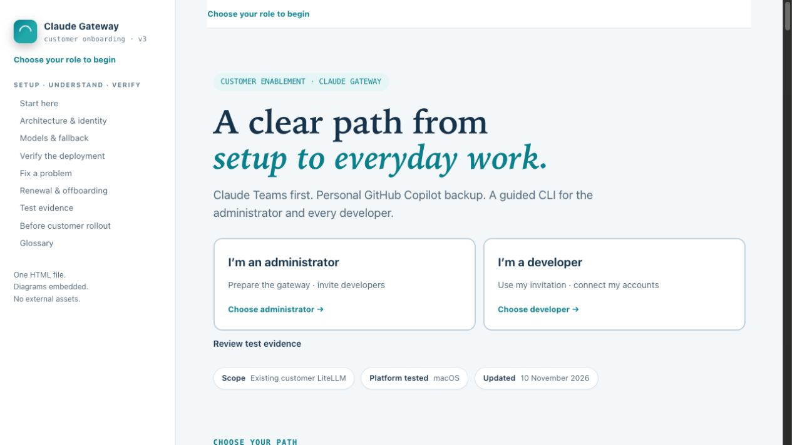
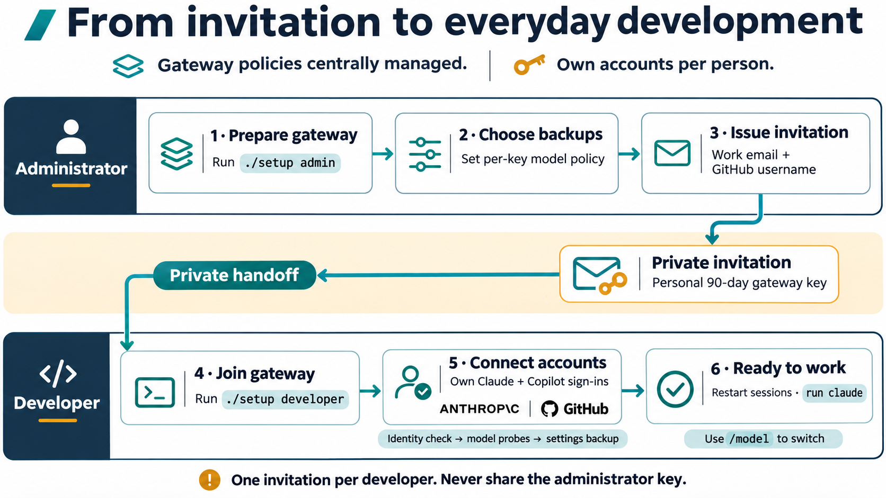
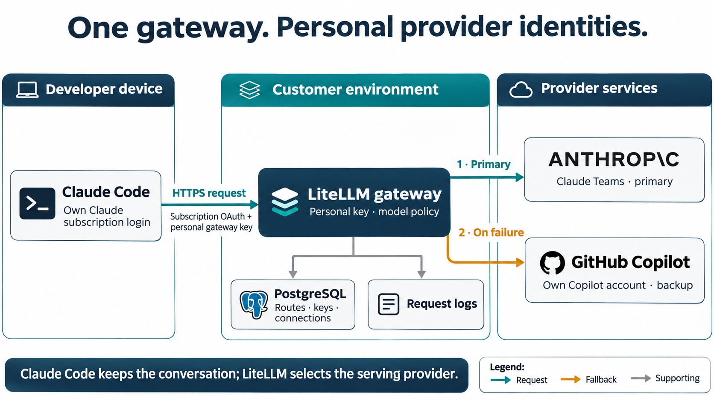
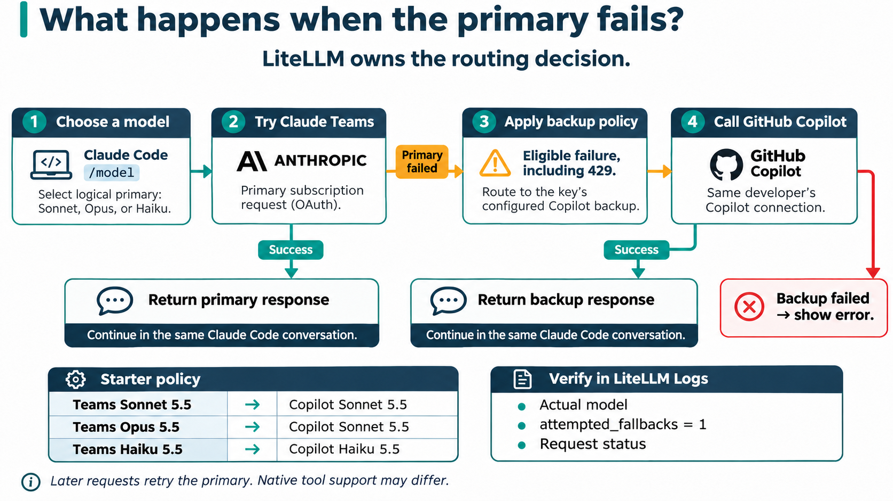

# Claude Teams + LiteLLM + GitHub Copilot

**One onboarding flow. Personal provider identities. Automatic fallback at the gateway.**

This onboarding package connects Claude Code to an **existing customer LiteLLM gateway**. Requests first use the developer’s eligible Claude Teams subscription. If a mapped primary request fails with an eligible provider error, LiteLLM tries the configured GitHub Copilot model using that developer’s connected account.

After onboarding, developers run `claude` normally. They can switch models with `/model`; the gateway owns the fallback policy.

> **Get started:** Administrators configure the gateway and invite developers. Developers connect their accounts once, then use Claude Code normally with automatic fallback managed by LiteLLM.

## Start here

| Your role | Start with | You need |
|---|---|---|
| **Administrator** | `./setup admin` → Prepare customer gateway → Invite a developer | Existing gateway, administrator key, developer work email and GitHub username |
| **Developer** | `./setup developer` → Join with my invitation | Private invitation, Python 3.10+, Claude Code, your Claude and GitHub accounts |
| **Reviewer / operator** | [Architecture](#how-requests-flow), [configuration](docs/CONFIGURATION.md), [validation guide](docs/VALIDATION.md) | Read access to this repository |

### Interactive onboarding guide

**[Open the onboarding website](https://msftse-org.github.io/claude-teams-litellm-copilot/)** · **[Download the standalone HTML guide](https://github.com/msftse-org/claude-teams-litellm-copilot/releases/latest/download/START-HERE.html)** · **[Download the customer CLI package](https://github.com/msftse-org/claude-teams-litellm-copilot/releases/latest/download/claude-gateway-cli.zip)** · [Guide source file](START-HERE.html)

Open the onboarding website directly in your browser, or download `START-HERE.html` for offline use. The guide runs offline, embeds all three diagrams, and starts with **no role selected**. Choose Administrator or Developer to reveal that role’s four setup steps. A persistent label shows the selected journey; “Change role” switches paths. Shared architecture, model and troubleshooting references remain available.



The guide, source code and release downloads are public. Each developer’s invitation is a separate private credential and must be delivered through an approved recipient-restricted channel.

## Administrator journey

From the extracted package or cloned repository folder:

```sh
python3 --version
./setup admin
```

1. **Prepare once.** Enter the gateway HTTPS origin and administrator key. Review and install the model routes and per-user Copilot credential definition. Matching routes are reused; conflicts stop for review.
2. **Invite each developer.** Enter their work email and exact GitHub username. Select the recommended policy or a different offered backup for each primary family.
3. **Deliver privately.** Share the package and that developer’s `.invite.json` through a recipient-restricted channel. Use [HANDOFF-TEMPLATE.txt](HANDOFF-TEMPLATE.txt).
4. **Verify the connection.** Confirm requests and model routing in LiteLLM Logs before inviting the rest of the team.

The email identifies the LiteLLM user and supports repeat enrollment. **No email is sent or verified, and SMTP is not required.** The invitation contains a personal 90-day gateway key. It does not contain the administrator key or provider sign-in tokens. Each developer gets their own file.

### Existing gateway requirements

- Customer HTTPS origin, PostgreSQL, and `general_settings.store_model_in_db: true`.
- Administrator access to models, credentials, users and virtual keys.
- Required egress and developer network access to the gateway and provider sign-in endpoints.
- The APIs and per-user OAuth behavior validated on **LiteLLM 1.108.0**.
- A separately eligible Claude seat and Copilot entitlement for every developer.

This repository configures an existing deployment. It does not provision hosting, TLS, database infrastructure, SMTP, organization-wide SSO, budgets or high availability.

## Developer journey

Get the package and your private invitation from the administrator. In the folder containing `setup`:

```sh
python3 --version
claude --version
./setup developer
```

Choose **Join with my invitation**, provide the invitation file, and sign into the expected accounts when prompted. The wizard validates identity and model access, backs up settings, and configures the gateway. Restart open Claude Code sessions, then:

```sh
claude
```

Use these commands to inspect the connection and your live model policy:

```sh
./setup doctor
./setup models
```

No special launcher is needed after joining. The wizard updates `~/.claude/settings.json`, retaining unrelated settings and permissions. Shell, project or managed settings can override user settings; inspect those if traffic takes a different route. Restore is available in the Developer menu and protects later edits.



## How requests flow



1. Claude Code maintains the developer’s Claude subscription sign-in and sends requests to the customer gateway. A separate personal LiteLLM key identifies the gateway user.
2. LiteLLM authenticates the key and routes a mapped primary model to Anthropic using the client’s subscription token.
3. On an eligible failure, LiteLLM applies that key’s fallback mapping and uses the developer’s Copilot connection.
4. Claude Code receives the response through the same gateway. LiteLLM Logs identify the actual provider, model and fallback attempts.

This uses native LiteLLM routes, credentials and key-level router settings. There is no custom request adapter or modified LiteLLM container image in the package. The architecture covers Claude Teams as the primary provider and GitHub Copilot as the backup provider.

## Models and fallback policy

| Requested primary | Default Copilot backup | Direct backup alias |
|---|---|---|
| Sonnet 5.5 — initial default | Sonnet 5.5 | `claude-copilot-sonnet` |
| Opus 5.5 | Sonnet 5.5 | `claude-copilot-sonnet` |
| Haiku 5.5 | Haiku 5.5 | `claude-copilot-haiku` |
| Sonnet 5 | Sonnet 5 | `claude-copilot-sonnet-5` |
| Haiku 4.5 | Haiku 4.5 | `claude-copilot-haiku-4-5` |

Use `/model` in Claude Code to choose a primary, or enter a direct alias such as `/model claude-copilot-sonnet`. The administrator can choose another offered backup during invitation creation. Optional Copilot Opus requires separately verified access and was **not live-tested** in the test account.



- Generated keys use `num_retries: 0` and one backup for each mapped primary. General eligible provider failures can trigger fallback; it is not restricted to subscription quota exhaustion.
- Direct Copilot aliases have no further fallback. If both providers fail, the request fails.
- These shared routes disable deployment cooldown, so one user’s limit does not cool down the route for everyone. Later requests try the primary again.
- The primary wildcard can expose additional models; only explicit mappings in the [catalog](_engine/catalog.json) have a configured fallback.
- Claude Code can continue displaying the requested primary model. Inspect LiteLLM Logs for `attempted_fallbacks`, the actual model, status and request ID.
- Native WebSearch, partial streams and context limits are not guaranteed to behave identically across providers. Read-tool success is not full tool parity. Optional GitHub MCP search is separate and is not enabled by the wizard.

## Configuration and operations

[Configuration reference](docs/CONFIGURATION.md) explains the models, per-user credential, key policy, client settings and what is stored where. [_engine/catalog.json](_engine/catalog.json) is the checked-in model and fallback source of truth.

| Lifecycle action | Flow |
|---|---|
| Add a developer | Admin issues a distinct invitation; developer joins. No gateway redeployment. |
| Repeat enrollment | Same gateway and normalized email reuse the user. Reusing a valid invitation file reuses its key. |
| Renew or change policy | Issue a new invitation filename/key, revoke the old key as appropriate, and have the developer join again. |
| Offboard | Block/delete the developer’s gateway key and review provider access separately. |
| Restore workstation | Developer menu → Restore previous settings. This does not revoke the key or provider connection. |

## Validation and limitations

Compatibility checks cover macOS, LiteLLM 1.108.0 and Claude Code 2.1.317:

- **17 automated tests** for onboarding, identity checks, settings merge/restore, malformed invitations and wrapper behavior.
- Three primary and four direct Copilot model selections responded successfully.
- After genuine subscription quota exhaustion, **Sonnet, Opus and Haiku all fell back successfully**; gateway records show `attempted_fallbacks=1`. A primary-only diagnostic returned real Anthropic HTTP 429.
- A Read-tool call and follow-up succeeded through fallback.
- Live invitation creation and developer validation passed with automatic email explicitly disabled.

See the [validation checklist](docs/VALIDATION.md) and [aggregate compatibility results](VALIDATION.json). Raw provider logs, request IDs and account details are not included. Complete first-time browser consent and verify your organization’s network, policies and required tools during deployment. Read-tool validation does not cover every tool or context size.

Run offline checks without provider credentials (maintainer checks require Python 3.10+ and Node.js for JavaScript syntax validation):

```sh
python3 -m unittest discover -s tests
python3 tools/build_guide.py
python3 tools/check_package.py
python3 tools/check_public.py
```

The guide build uses only checked-in sources and embeds the diagram PNGs. Automated checks do not consume provider quota.

## Repository contents

| Path | Purpose |
|---|---|
| `setup` | Guided CLI entry point |
| `_engine/` | Python implementation, explicit model catalog, optional search helper |
| `START-HERE.html` | Standalone interactive onboarding guide |
| `tools/` | Reproducible guide build and package checks |
| `docs/CONFIGURATION.md` | Administrator configuration reference |
| `diagrams/` | Three architecture PNGs used in this README and guide |
| `tests/` | Offline tests |
| `HANDOFF-TEMPLATE.txt` | Private delivery instructions |
| `VALIDATION.json`, `docs/VALIDATION.md` | Aggregate results and repeatable deployment checks |
| `IMAGE-PROMPTS.txt` | Architecture image generation provenance |

Private invitation files, environment files and credential files are excluded from version control. Do not commit live keys or tokens.

## References

- [LiteLLM: Claude subscription authentication](https://docs.litellm.ai/docs/tutorials/claude_code_max_subscription)
- [LiteLLM: GitHub Copilot provider](https://docs.litellm.ai/docs/providers/github_copilot)
- [LiteLLM: reliability and fallback](https://docs.litellm.ai/docs/proxy/reliability)
- [LiteLLM: model fallback tutorial](https://docs.litellm.ai/docs/tutorials/model_fallbacks)
- [LiteLLM: per-key router settings](https://docs.litellm.ai/docs/proxy/keys_teams_router_settings)
- [Related team example: Claude Code with GitHub Copilot](https://github.com/msftse-org/claude-code-with-github-copilot)
